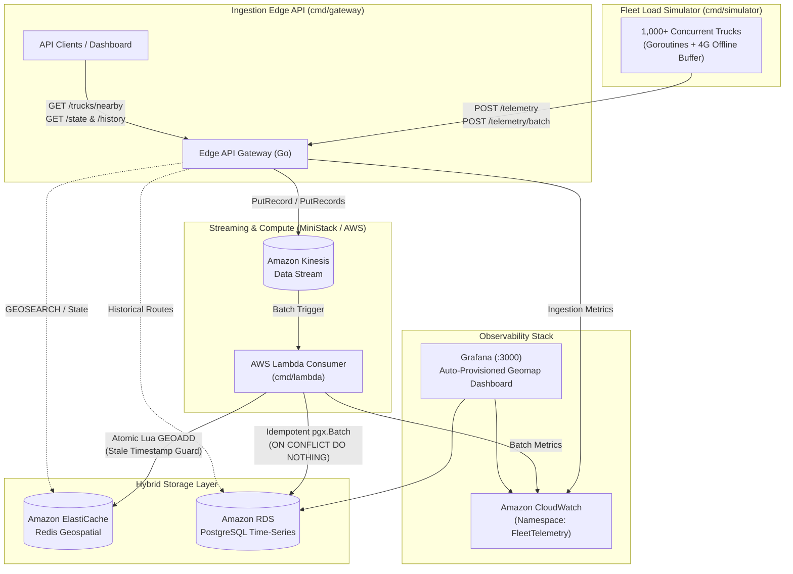

# Real-Time Fleet Telemetry & Geospatial Tracking System (Go)

An end-to-end, event-driven architecture for real-time fleet telemetry ingestion, streaming, hybrid geospatial/time-series storage, and live observability built with **Go**, **Amazon Kinesis**, **AWS Lambda**, **Amazon ElastiCache (Redis)**, **Amazon RDS (PostgreSQL)**, **Amazon CloudWatch**, **Grafana**, **MiniStack**, and **Terraform**.

---

## Key Engineering Highlights

- **Out-of-Order & Stale Data Protection (Redis Lua `GEOADD`):** Atomic Lua scripts compare incoming GPS packet timestamps against the latest stored state, rejecting delayed 4G packets so vehicles never "jump backward in time" on the live map while supporting fast radius queries via `GEOSEARCH`.
- **Idempotent Time-Series Persistence (`pgx.Batch`):** The AWS Lambda consumer processes Kinesis batches using `ON CONFLICT (event_id) DO NOTHING` to absorb Lambda retries and duplicate deliveries without data corruption, returning historical routes strictly ordered by original device timestamps.
- **4G Signal-Drop Simulation & Offline Buffering:** A concurrent Go load simulator models 1,000+ trucks with configurable cellular dead zones, buffering telemetry locally with original timestamps and flushing via `POST /telemetry/batch` once connectivity returns.
- **Domain & Physical Validation (WGS84):** Enforces strict coordinate bounds (`[-90, 90]`, `[-180, 180]`), rejects `(0,0)` null-island payloads, and validates physical limits for speed, fuel, and heading/azimuth.
- **Full Local AWS Parity & Observability:** Runs completely locally using **MiniStack** (Kinesis, Lambda, CloudWatch) provisioned via **Terraform**, with an auto-provisioned **Grafana Geomap** dashboard for live fleet tracking.

---

## System Architecture



---

## Tech Stack

| Layer | Technology | Purpose |
| --- | --- | --- |
| **Language** | Go | Edge API Gateway, AWS Lambda consumer, and concurrent load simulator |
| **Streaming** | Amazon Kinesis (AWS SDK v2) | High-throughput ingestion buffer decoupling edge traffic from storage |
| **Compute** | AWS Lambda | Batch stream consumer writing to Redis and PostgreSQL |
| **Hot Geospatial Store** | Amazon ElastiCache (Redis) + Lua | Atomic `GEOADD` with timestamp guard and `GEOSEARCH` radius queries |
| **Cold Time-Series Store** | Amazon RDS (PostgreSQL + `pgx`) | Idempotent batch inserts and ordered historical telemetry queries |
| **Observability** | Amazon CloudWatch & Grafana | Custom `FleetTelemetry` metrics and auto-provisioned live Geomap dashboard |
| **Infrastructure as Code** | Terraform & MiniStack | Local AWS emulation (`localhost:4566`) and reproducible resource provisioning |

---

## Project Structure

```text
Geo-Location/
├── cmd/
│   ├── gateway/
│   │   ├── main.go              # Edge API (POST /telemetry, /telemetry/batch, GET /trucks/nearby, /state, /history)
│   │   └── main_test.go         # End-to-end integration test (Gateway + Kinesis + Redis + PostgreSQL)
│   ├── lambda/
│   │   ├── main.go              # AWS Lambda Consumer (Kinesis batches -> Redis GEOADD + PostgreSQL Batch Insert)
│   │   └── main_test.go         # AWS Lambda handler tests with late-arriving events and corrupted records
│   └── simulator/
│       ├── main.go              # Load Simulator (Goroutines + 4G signal-drop offline buffer)
│       └── main_test.go         # Kinematics, heading/azimuth, and post-outage batch flush tests
├── internal/
│   ├── config/                  # Centralized environment-based configuration (+ tests)
│   ├── domain/                  # Telemetry structs & WGS84 physical validation rules (+ tests)
│   ├── kinesis/                 # AWS SDK v2 Kinesis client (+ real MiniStack integration tests)
│   ├── observability/           # Amazon CloudWatch metrics publisher (+ real MiniStack integration tests)
│   └── storage/
│       ├── redis.go             # Atomic GEOADD via Lua Script + radius GEOSEARCH (+ real Redis tests)
│       └── postgres.go          # Idempotent batch insert (pgx.Batch) & time-series history (+ real Postgres tests)
├── observability/
│   └── grafana/                 # Auto-provisioned Datasources & Real-Time Geomap Dashboard
├── infra/                       # Terraform IaC targeting MiniStack (localhost:4566)
├── docs/
│   └── telemetry_schema.json    # JSON Schema (Draft 2020-12) for telemetry payloads
├── sql/
│   └── init.sql                 # PostgreSQL DDL & time-series indexes
├── scripts/
│   ├── build-lambda.ps1         # Builds Linux 'bootstrap' binary and packages build/lambda_function.zip
│   └── terraform-apply.ps1      # Runs Terraform (local or via hashicorp/terraform Docker image) against MiniStack
└── docker-compose.yml           # MiniStack (4566), Redis (6379), PostgreSQL (5432), and Grafana (3000)

```

---

## Getting Started (End-to-End Execution)

### 1. Start Local Infrastructure (Docker Compose)

```powershell
docker compose up -d

```

Available services:

* **MiniStack (Local AWS):** `http://localhost:4566`
* **Grafana (Real-Time Dashboard & Geomap):** `http://localhost:3000` (anonymous access or `admin` / `admin`)
* **Redis (ElastiCache):** `localhost:6379`
* **PostgreSQL (RDS):** `localhost:5432`

### 2. Provision AWS Resources on MiniStack via Terraform

Even without the `terraform` binary installed locally on Windows, the script below compiles the Linux Lambda package (`bootstrap`) and executes Terraform automatically via Docker:

```powershell
powershell -ExecutionPolicy Bypass -File .\scripts\terraform-apply.ps1

```

### 3. Start the Ingestion Edge API Gateway

```powershell
go run ./cmd/gateway

```

### 4. Start the AWS Lambda / Kinesis Consumer Worker

```powershell
go run ./cmd/lambda

```

### 5. Run the Load Simulator (Goroutines + 4G Outage Simulation)

```powershell
# Simulates 1,000 trucks every 2s with a 5% probability of entering a 4G dead zone and buffering batches
go run ./cmd/simulator -trucks=1000 -interval=2s -offline-prob=0.05

```

---

## Running the Test Suite (Unit + Real Integration Tests)

With the `docker compose` containers running, execute:

```powershell
go test -v ./...

```

What the suite validates in practice:

* **Domain & Physical Constraints (`internal/domain`):** WGS84 coordinate bounds (`[-90, 90]`, `[-180, 180]`), rejection of `(0,0)` null-island coordinates, and valid physical ranges for fuel, speed, and heading/azimuth.
* **Stale & Out-of-Order Data Protection in Redis (`internal/storage/redis_test.go`):** Verifies that the Redis Lua script rejects packets with a `timestamp` older than the currently stored state (preventing delayed 4G packets from making a truck jump backward on the live map) and validates `GEOSEARCH` spatial accuracy across 5 km and 25 km radii.
* **Ordering & Idempotency in PostgreSQL (`internal/storage/postgres_test.go`):** Sends out-of-order and duplicated batches (simulating AWS Lambda retries) to verify that `ON CONFLICT (event_id) DO NOTHING` prevents duplicates and that queries return the time series strictly ordered by the truck's original `timestamp`.
* **Kinesis Streaming on MiniStack (`internal/kinesis/client_test.go`):** Creates a real stream on MiniStack, publishes via `PutRecord` and `PutRecords`, and reads directly from the Shard via `GetShardIterator` + `GetRecords`.
* **CloudWatch Metrics on MiniStack (`internal/observability/cloudwatch_test.go`):** Publishes real ingestion and batch-processing metrics and verifies them via `ListMetrics` under the `FleetTelemetry` namespace.
* **4G Signal-Drop Buffering (`cmd/simulator/main_test.go`):** Verifies that during a 4G outage, trucks buffer telemetry events locally while preserving each event's original collection timestamp and flush the full batch to `POST /telemetry/batch` once connectivity is restored.
